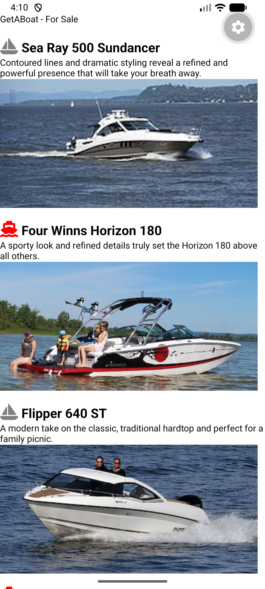

<!-- Create a file README.MD in L04Boats folder and paste following content in it -->
# App Name

This app allows users to browse a catalog of powerboats offered by GetABoat, displaying boat names, detailed descriptions, icons, and visual image previews within a mobile application built with React Native.

# ScreenShots of App
Top page screenshot:  

Bottom page screenshot:  
